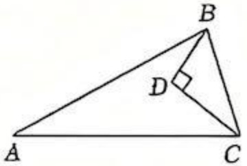

如图，D 为 $\triangle ABC$ 内一点，CD 平分 $\angle ACB$， $BD \perp CD$， $\angle A = \angle ABD$，若 $\angle BCD = 34^\circ$，则 $\angle A$ 的度数为（ ）

A. $34^\circ$

B. $30^\circ$

C. $28^\circ$

D. $27^\circ$

> [!question]- 点击查看答案与解析
> 【答案】A
> 
> 【考点】角平分线的性质，直角三角形的性质，三角形内角和定理 → [[【初中数学知识点体系-人教版】#13-3 三角形的内角与外角]]
> 
> 【解析】
> - 因为$CD$平分$\angle ACB$，$\angle BCD = 34^\circ$，所以$\angle ACB = 2 \times 34^\circ = 68^\circ$；
> - 因为$BD \perp CD$，所以$\angle BDC = 90^\circ$，在$\triangle BDC$中，$\angle DBC = 180^\circ - 90^\circ - 34^\circ = 56^\circ$；
> - 设$\angle A = \angle ABD = x$，在$\triangle ABC$中，$\angle A + \angle ABD + \angle DBC + \angle ACB = 180^\circ$，即$x + x + 56^\circ + 68^\circ = 180^\circ$；
> - 解得$2x = 56^\circ$，$x = 34^\circ$，即$\angle A = 34^\circ$。
> 
> 【易错点】忽略角平分线的倍数关系，或在三角形内角和计算时漏加角。
