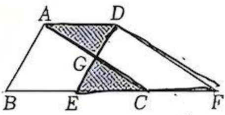

如图，在三角形 ABC 中， $AB = 6cm$， $AC = 8cm$， $BC = 10cm$，将三角形 ABC 沿 BC 方向平移，得到三角形 DEF，且 AC 与 DE 相交于点 G，连接 AD．则阴影部分的两个三角形周长之和为 ___ cm．

> [!question]- 点击查看答案与解析
> 【答案】24
> 
> 【考点】平移的性质，三角形周长计算 → [[【初中数学知识点体系-人教版】#7-4 平移]]
> 
> 【解析】
> 平移后$AD = BE$，$AB = DE$，$AC = DF$，阴影部分两个三角形周长之和$= AB + AC + BC = 6 + 8 + 10 = 24$，因为平移不改变边长，阴影部分周长等价于原三角形周长。
> 
> 【易错点】平移性质理解错误，漏加边长。
