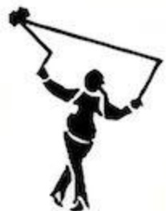
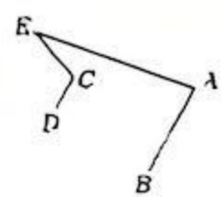

空竹在我国有悠久的历史，明代《帝京景物略》一书中就记载了空竹的玩法和制作方法，抖空竹是靠四肢配合完成的运动项目，被誉为“中华传统体育文化的瑰宝”、2006年5月20日，抖空竹被列入第一批国家级非物质文化遗产名录，在观察抖空竹时发现，可以从运动员某一时刻的姿势中抽象出数学问题：如图，$AB \parallel CD$，$\angle E = 25^{\circ}$，$\angle ECD = 105^{\circ}$，则 $\angle A$的度数为___ 。

> [!question]- 点击查看答案与解析
> 【答案】$80^\circ$
> 
> 【考点】平行线的性质，三角形外角定理 → [[【初中数学知识点体系-人教版】#7-2 平行线]]
> 
> 【解析】
> 过点$E$作$EF \parallel AB$，因为$AB \parallel CD$，所以$EF \parallel CD$；
> $\angle ECD = 105^\circ$，所以$\angle FEC = 180^\circ - 105^\circ = 75^\circ$；
> $\angle AEF = \angle A$，$\angle AEC = \angle AEF + \angle FEC = 25^\circ$，所以$\angle AEF = 80^\circ$，即$\angle A = 80^\circ$。
> 
> 【易错点】辅助线添加错误，三角形外角与内角的关系混淆。
