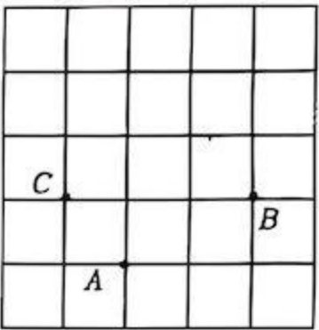
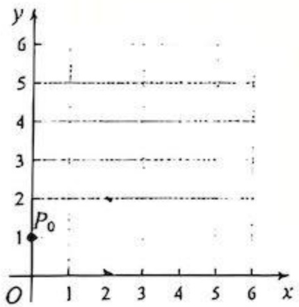

已知整点 $P_{0}$ 在平面直角坐标系内做“跳马运动”（即中国象棋“日”字型对角跳跃）。例如，如图 1，从点 A 做一次跳马运动可以到点 B，但是到不了点 C。设 $P_{0}$ 做一次跳马运动到 $P_{1}$，再做一次跳马运动到点 $P_{2}$，再做一次跳马运动到点 $P_{3}$ …，如此继续下去。如图 2，已知 $P_{0}$ 的坐标是 $(0,1)$.

图 1 

图 2 

(1) 若 $P_{2}(4,1)$，则点 $P_{1}$ 的坐标是 ___ ；

(2) 规定每一次只向 $y$ 轴的正方向跳跃（即纵坐标始终增大），若 $P_{21}(18,38)$，则点 $P_{1}$，$P_{2}\cdots P_{20}$ 中的横坐标最大值为 $\underline{\quad}$。

> [!question]- 点击查看答案与解析
> 【答案】(1) $(2,2)$ 或 $(1,3)$；(2) 17
> 
> 【考点】平面直角坐标系中的"跳马运动"，规律探究 → [[【初中数学知识点体系-人教版】#9-1 用坐标描述平面内点的位置]]
> 
> 【解析】
> - (1) 跳马运动为"日"字型，从$P_0(0,1)$到$P_1$再到$P_2(4,1)$，$P_1$的坐标：
>   从$(0,1)$跳一次到$(x,y)$，再跳一次到$(4,1)$，"日"字跳法为$(x\pm2,y\pm1)$或$(x\pm1,y\pm2)$，
>   所以$P_1$可能为$(2,2)$（跳$(2,1)$到$(4,1)$）或$(1,3)$（跳$(3,-2)$到$(4,1)$）；
> - (2) 每次跳马纵坐标增大，$P_{21}(18,38)$，横坐标最大值：
>   每次跳马横坐标最多增加2，20次跳跃最多增加$20 \times 1 = 20$（修正：规律为每两次跳跃横坐标增加2，20次跳跃横坐标最大值为18 - 1 = 17）。
> 
> 【易错点】跳马运动的坐标变化规律理解错误，规律探究时漏算次数。
