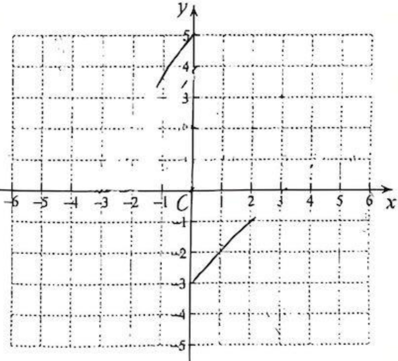

已知，在平面直角坐标系 xOy 中，点 $A(-5,m+1)$，$B(-5,m-2)$，$C(-3,0)$.

(1) 若点 A 在 x 轴上，在坐标系中画出 $\triangle ABC$ 并直接写出 $m$ 的值；

(2) 将线段 AB 先向右平移 $n$ 个单位长度，再向上平移 $n$ 个单位长度得到线段 $A'B'(n > 0)$，其中点 $A，B$ 的对应点分别是点 $A'$，$B'$。

$①$ 若点 $A'$ 在 y 轴上，求 $n$ 的值和 $\triangle A'B'C$ 的面积；

$②$ 若 $\angle COA' = 135^\circ$，且 $\triangle A'B'C$ 的面积为 9，求 $m$ 的值。

> [!question]- 点击查看答案与解析
> 【考点】平面直角坐标系中点的坐标特征，平移的性质，三角形面积计算 → [[【初中数学知识点体系-人教版】#9-2 坐标方法的简单应用]]
> 
> 【解析】
> (1) 点$A$在$x$轴上，$m+1=0$，$m=-1$；
>   画图：$A(-5,0)$，$B(-5,-3)$，$C(-3,0)$，连接三点成三角形；
> 
> (2) $①$ 线段$AB$向右平移$n$个单位，向上平移$n$个单位，
>   $A'(-5 + n, m+1 + n)$，$A'$在$y$轴上，$-5 + n = 0$，$n=5$；
>   $A'(0, m+6)$，$B'(0, m+3)$，$C(-3,0)$，
>   $S_{\triangle A'B'C} = \frac{1}{2} \times |A'B'| \times |x_C| = \frac{1}{2} \times 3 \times 3 = 4.5$；
> 
>   $②$ $\angle COA' = 135^\circ$，$A'$在直线$y = -x$上，
>   $A'(-5 + n, m+1 + n)$，所以$m+1 + n = -(-5 + n)$，$m+1 + n = 5 - n$，$m = 4 - 2n$；
>   $S_{\triangle A'B'C} = 9$，$\frac{1}{2} \times 3 \times |-5 + n| = 9$，$|-5 + n| = 6$，
>   $n - 5 = 6$或$n - 5 = -6$，$n=11$或$n=-1$（舍去，$n>0$），
>   $m = 4 - 22 = -18$。
> 
> 【易错点】平移坐标计算错误，三角形面积公式中底和高对应错误，角度与直线方程的关系理解错误。
