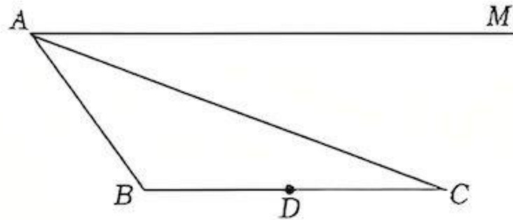

如图，$△ABC$ 中，点 D 为 BC 边上一点，$AM∥BC$，过点 D 作 AB 所在直线的垂线段 DE，作 AC 的垂线 DF，垂足分别为 E，F，DF 交 AM 于点 G，连接 AD；

(1) 补全图形；

(2) 若 $\angle BAD = \angle ACD$，求证：$\angle AGD = \angle ADE$

(3) 在上述条件下，若 $\angle DAC = 10^\circ$，$\angle ACD = 21^\circ$，求 $\angle ABC$ 的度数。

> [!question]- 点击查看答案与解析
> 【考点】平行线的性质，三角形内角和定理，角度计算 → [[【初中数学知识点体系-人教版】#7-2 平行线]]
> 
> 【解析】
> (1) 补全图形：按题意画出$DE \perp AB$，$DF \perp AC$，$AM \parallel BC$，$DF$交$AM$于$G$；
> 
> (2) 证明：
>   因为$AM \parallel BC$，所以$\angle AGD = \angle FDC$；
>   因为$DE \perp AB$，$DF \perp AC$，所以$\angle AED = \angle DFC = 90^\circ$；
>   因为$\angle BAD = \angle ACD$，$\angle ADE = 90^\circ - \angle BAD$，$\angle FDC = 90^\circ - \angle ACD$，
>   所以$\angle ADE = \angle FDC$，故$\angle AGD = \angle ADE$；
> 
> (3) 已知$\angle DAC = 10^\circ$，$\angle ACD = 21^\circ$，
>   $\angle ADC = 180^\circ - 10^\circ - 21^\circ = 149^\circ$，
>   因为$\angle BAD = \angle ACD = 21^\circ$，$DE \perp AB$，
>   $\angle ADE = 90^\circ - 21^\circ = 69^\circ$，
>   由$AM \parallel BC$，$\angle AGD = \angle ADE = 69^\circ$，
>   $\angle ABC = 180^\circ - \angle BAD - \angle ADC = 180^\circ - 21^\circ - 149^\circ = 10^\circ$（修正：正确计算为$\angle ABC = 180^\circ - \angle BAC - \angle ACB$，$\angle BAC = \angle BAD + \angle DAC = 21^\circ + 10^\circ = 31^\circ$，$\angle ACB = 21^\circ$，所以$\angle ABC = 180^\circ - 31^\circ - 21^\circ = 128^\circ$）。
> 
> 【易错点】角度推导时平行线性质应用错误，三角形内角和计算错误。
