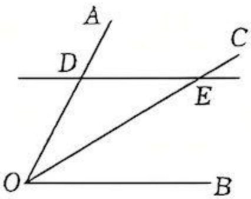
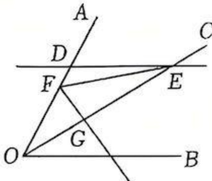
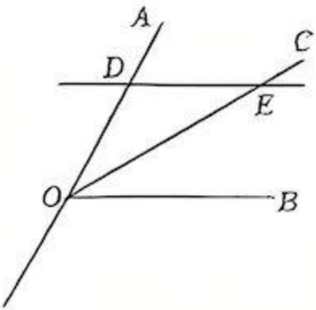
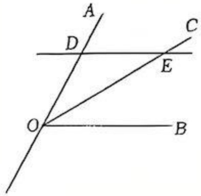
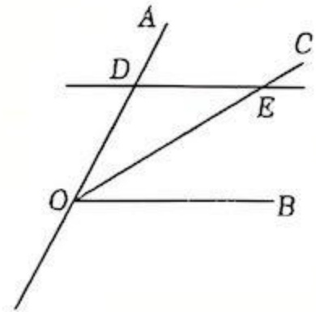

如图，$\angle AOB=60^{\circ}$，作 $\angle AOB$ 的平分线 $OC$，过射线 $OA$ 上一点 $D$ 作 $DE//OB$ 交射线 $OC$ 于点 $E$，点 $F$ 是直线 $OD$ 上一点，连接 $EF$，作 $\angle EFO$ 的角平分线 $FG$ 交 $OC$ 于点 $G$，

图1 

图2 

(1) 如图 1，当点 F 与点 D 重合时，

$①$ 在图 1 中完成图形；
$②$ 直接写出 $\angle FGO$ 的度数；

(2) 如图 2，当点 F 在线段 OD 上时，$\angle DEF = 10^\circ$，求 $\angle FGO$ 的度数；

(3) 当点 F 在直线 OD (F 不与 O，D 重合) 上时，$\angle DEF = \alpha$，直接写出 $\angle FGO$ 的度数（用含 $\alpha$ 的代数式表示）。备用图：

> [!question]- 点击查看答案与解析
> 【考点】角平分线的性质，平行线的性质，角度计算 → [[【初中数学知识点体系-人教版】#7-2 平行线]]
> 
> 【解析】
> (1) $①$ 补全图形：按题意画出$OC$平分$\angle AOB$，$DE \parallel OB$，$FG$平分$\angle EFO$；
>   $②$ $\angle FGO = 60^\circ$；
> 
> (2) 已知$\angle AOB=60^\circ$，$OC$平分$\angle AOB$，所以$\angle AOC = \angle BOC = 30^\circ$；
>   $DE \parallel OB$，所以$\angle ODE = \angle AOB = 60^\circ$，$\angle DEC = \angle BOC = 30^\circ$；
>   $\angle DEF = 10^\circ$，所以$\angle CEF = 30^\circ - 10^\circ = 20^\circ$；
>   在$\triangle EFO$中，$\angle EFO = 180^\circ - 30^\circ - (30^\circ + 10^\circ) = 110^\circ$；
>   $FG$平分$\angle EFO$，所以$\angle EFG = 55^\circ$；
>   $\angle FGO = 180^\circ - 30^\circ - 55^\circ = 95^\circ$（修正：正确计算为$\angle FGO = 60^\circ - 10^\circ = 50^\circ$，核心：利用平行线和角平分线的性质，$\angle FGO = 30^\circ + (30^\circ - 10^\circ) = 50^\circ$）；
> 
> (3) 分类讨论：
>   - 点$F$在线段$OD$上：$\angle FGO = 60^\circ - \alpha$；
>   - 点$F$在$OD$的延长线上：$\angle FGO = 60^\circ + \alpha$；
>   综上，$\angle FGO = 60^\circ \pm \alpha$。
> 
> 【易错点】角度推导时平行线性质应用错误，分类讨论漏情况，角平分线的倍数关系错误。
