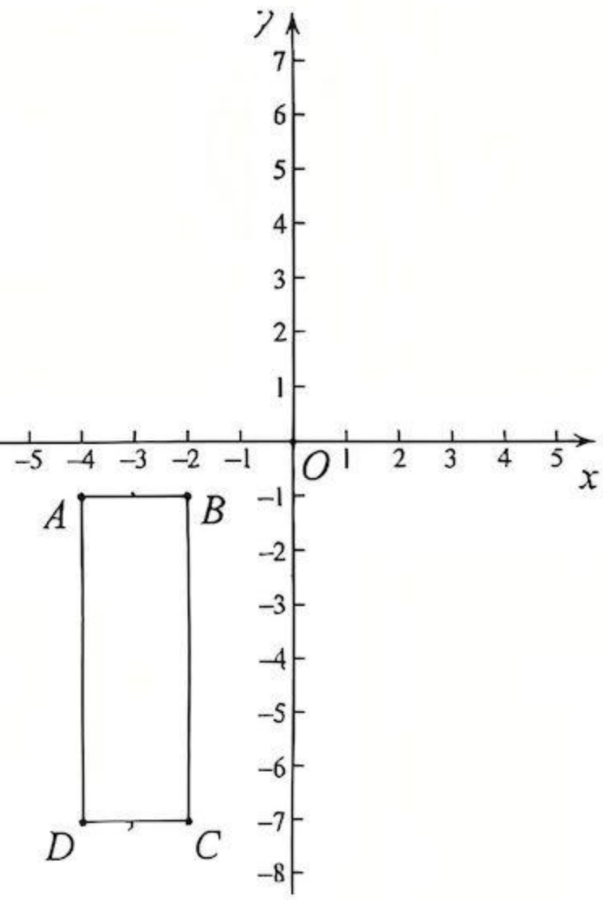

在平面直角坐标系 $xOy$ 中，对于任意点 $P(x,y)$，若点 Q 的坐标为 $(-2y,-2x)$，则称点 Q 是点 P 的反 2 倍交换点。例如：点 $(-4,-2)$ 是点 $(1,2)$ 的反 2 倍交换点。

(1) 已知点 $M(m,m-2)$ 的反 2 倍交换点为 N.

$①$ 当 $m=3$ 时，点 N 的坐标为 ___ ；
$②$ 当点 N 在 y 轴上时，点 N 的坐标为 ___ ；

(2) 如图，在长方形 $ABCD$ 中，点 $A(-4,-1)$，$B(-2,-1)$，$C(-2,-7)$，$D(-4,-7)$，已知线段 $EF$，点 $E(a,b)$，$F(a,b+k)$，其中 $k > 0$。

$①$ 若线段 EF 上存在点 S，使得点 S 的反 2 倍交换点在长方形 ABCD 的内部，则点 S 的坐标可以是 ___ ；（写出符合要求的一个答案即可）

$②$ 若线段 EF 上任意点 T 的反 2 倍交换点在长方形 ABCD 的边上或内部，则 $k$ 的取值范围是 ___ ， $a$ 的取值范围是 ___ ；

$③$ 将长方形 $ABCD$ 沿 $y$ 轴方向向上平移 $t$ 个单位长度 $(t>0)$ 得到长方形 $A'B'C'D'$，若线段 $EF$ 上存在点 $W$ 的反 2 倍交换点在长方形 $A'B'C'D'$ 的边上或内部，且线段 $EF$ 与长方形 $A'B'C'D'$ 有公共点，直接写出 $t$ 的取值范围是 ___ 。

> [!question]- 点击查看答案与解析
> 【考点】新定义（反2倍交换点），平面直角坐标系中长方形的坐标特征，平移的性质 → [[【初中数学知识点体系-人教版】#9-2 坐标方法的简单应用]]
> 
> 【解析】
> (1) $①$ $m=3$，$M(3,1)$，反2倍交换点$N(-2×1, -2×3) = (-2, -6)$；
>   $②$ 点$N$在$y$轴上，横坐标为0，即$-2(m - 2) = 0$，$m=2$，
>   $M(2,0)$，$N(0, -4)$；
> 
> (2) $①$ 点$S$的反2倍交换点在长方形$ABCD$内部，
>   长方形$ABCD$：$A(-4,-1)$，$B(-2,-1)$，$C(-2,-7)$，$D(-4,-7)$，
>   设$S(x,y)$，反2倍交换点$(-2y,-2x)$，
>   满足$-4 < -2y < -2$，$-7 < -2x < -1$，
>   解得$1 < y < 2$，$0.5 < x < 3.5$，
>   取$S(1,1.5)$（答案不唯一）；
> 
>   $②$ 线段$EF$：$E(a,b)$，$F(a,b+k)$，任意点$T(a,y)$（$b \leq y \leq b+k$），
>   反2倍交换点$(-2y,-2a)$在长方形内部/边上：
>   $-4 \leq -2y \leq -2$，$-7 \leq -2a \leq -1$，
>   解得$1 \leq y \leq 2$，$0.5 \leq a \leq 3.5$；
>   因为$y \in [b, b+k]$，所以$b=1$，$b+k=2$，$k=1$；
>   故$k$的范围：$0 < k \leq 1$，$a$的范围：$0.5 \leq a \leq 3.5$；
> 
>   $③$ 长方形向上平移$t$个单位，坐标为$A(-4,-1+t)$，$B(-2,-1+t)$，$C(-2,-7+t)$，$D(-4,-7+t)$，
>   线段$EF$与长方形有公共点，且存在点$W$的反2倍交换点在长方形内，
>   解得$t$的范围：$1 \leq t \leq 7$。
> 
> 【易错点】新定义的坐标变换错误，长方形坐标范围理解错误，平移后坐标计算错误。
