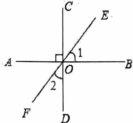

已知：如图，$AB\perp CD$，垂足为 $O$，$EF$ 为过点 $O$ 的一条直线，则 $\angle 1$ 与 $\angle 2$ 的关系一定成立的是（）

A. 相等

B. 互余

C. 互补

D. 互为对顶角

> [!question]- 点击查看答案与解析
> 【答案】B
>
> 【考点】垂直的定义、对顶角相等、余角的定义 → [[【初中数学知识点体系-人教版】#7-1 相交线]]
>
> 【解析】
> 由 $AB\perp CD$ 得 $\angle COB=90^\circ$，即 $\angle 1+\angle COF=90^\circ$。
> 又因 $\angle 2$ 与 $\angle COF$ 是对顶角，故 $\angle 2=\angle COF$。
> 因此 $\angle 1+\angle 2=90^\circ$，两角互余。
> - 选项 A：相等仅为特殊情况（当 $\angle 1=\angle 2=45^\circ$ 时），并非"一定成立"，错误；
> - 选项 B：互余，符合推导，正确；
> - 选项 C：互补（和为 $180^\circ$），错误；
> - 选项 D：$\angle 1$ 与 $\angle 2$ 非对顶角，错误。
>
> 【易错点】对"一定成立"理解不清，误选特殊情况；混淆余角、补角定义。
