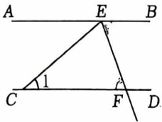

如图，已知直线 $AB\parallel CD$，$EF$ 平分 $\angle CEB$，若 $\angle 2=70^\circ$，则 $\angle 1$ 的度数为（ ）

A. $40^\circ$

B. $50^\circ$

C. $60^\circ$

D. $70^\circ$

> [!question]- 点击查看答案与解析
> 【答案】A
>
> 【考点】平行线的性质（内错角相等）、角平分线的定义 → [[【初中数学知识点体系-人教版】#7-2 平行线]]
>
> 【解析】
> 由 $AB\parallel CD$，得 $\angle BEF=\angle 2=70^\circ$（内错角相等）。
> $EF$ 平分 $\angle CEB$，故 $\angle CEF=\angle BEF=70^\circ$。
> 由图可知，$\angle 1$、$\angle CEF$、$\angle 2$ 在点 $E$ 处构成平角，即 $\angle 1+\angle CEF+\angle BEF=180^\circ$。
> 因此 $\angle 1=180^\circ-70^\circ-70^\circ=40^\circ$。
>
> 【易错点】平行线性质应用错误；角平分线度数计算错误；角度和差关系判断错误。
