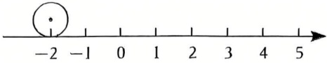

如图，直径为 1 个单位长度的圆，从数轴上表示数 -2 的点向右滚动一周到点 $N$，则点 $N$ 表示的数为（）

A. $\pi-2$

B. $\pi-1$

C. $\pi+2$

D. $\pi$

> [!question]- 点击查看答案与解析
> 【答案】A
>
> 【考点】实数与数轴的对应关系、圆的周长公式 → [[【初中数学知识点体系-人教版】#8-3 实数及其简单运算]]
>
> 【解析】
> 圆的直径为1，则周长 $C=\pi d=\pi\times1=\pi$。
> 圆从数轴上表示-2的点向右滚动一周，相当于在数轴上向右移动了 $\pi$ 个单位长度。
> 因此点N表示的数为 $-2+\pi=\pi-2$。
> - 选项A：$\pi-2$，正确；
> - 选项B：$\pi-1$，错误；
> - 选项C：$\pi+2$，错误；
> - 选项D：$\pi$，错误。
>
> 【易错点】混淆圆的周长公式；数轴上移动方向判断错误（向右为加，向左为减）。
