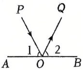
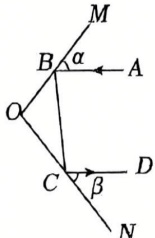

如图 1，已知 $AB$ 是一块平面镜，光线 $PO$ 在平面镜 $AB$ 上经点 $O$ 反射后，形成反射光线 $OQ$，我们称 $PO$ 为入射光线，$OQ$ 为反射光线。镜面反射有如下性质：入射光线与平面镜的夹角等于反射光线与平面镜的夹角，即 $\angle 1=\angle 2$ 。如图 2，$OM$ 和 $ON$ 是两块平面镜，入射光线 $AB$ 经过两次反射后，得到反射光线 $CD$ 。则下列判断错误的是（）

图 1

图 2

A. 若 $\alpha=45^\circ$，则 $AB\perp BC$

B. 若 $BC\perp CD$，则 $\beta=45^\circ$

C. 若 $AB\parallel CD$，则 $\alpha+\beta=90^\circ$

D. 若 $\alpha=\beta$，则 $AB\parallel CD$

> [!question]- 点击查看答案与解析
> 【答案】C
>
> 【考点】平行线的性质与判定、光的反射（入射角等于反射角） → [[【初中数学知识点体系-人教版】#7-2 平行线]]
>
> 【解析】
> 根据"入射光线与平面镜的夹角等于反射光线与平面镜的夹角"，在两次反射中，光线在点B处与镜面OM的夹角为α，在点C处与镜面ON的夹角为β。
> 由三角形OBC的角度关系可得镜面夹角 $\theta=\alpha+\beta$，光线经过两次反射的总偏转角为 $2(\alpha+\beta)$。
> 逐一分析：
> - 选项A：$\alpha=45^\circ$ 时，在反射点B处，入射光线与反射光线的夹角为 $2\times45^\circ=90^\circ$，即 $AB\perp BC$，正确；
> - 选项B：$BC\perp CD$ 时，在反射点C处偏转角为 $90^\circ$，即 $2\beta=90^\circ$，$\beta=45^\circ$，正确；
> - 选项C：$AB\parallel CD$ 时，总偏转角为 $180^\circ$，即 $2(\alpha+\beta)=180^\circ$，$\alpha+\beta=90^\circ$。此结论实际正确；
> - 选项D：$\alpha=\beta$ 时，不能保证总偏转角为 $180^\circ$（需 $\alpha+\beta=90^\circ$ 才行），故不能推出 $AB\parallel CD$，错误。
>
> 【易错点】混淆"入射光线与平面镜的夹角"和"入射光线与法线的夹角"；平行线条件与角度关系的推导错误。
