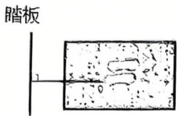
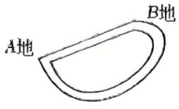

下列三个日常现象：

① 跳远测量

② 道路改道

③ 木条固定

其中，可以用"垂线段最短"来解释的是 \_\_\_。（填序号）

> [!question]- 点击查看答案与解析
> 【答案】$①$
>
> 【考点】垂线段最短 → [[【初中数学知识点体系-人教版】#7-1 相交线]]
>
> 【解析】
> 逐一分析：
> - $①$ 跳远测量：测量起跳点到落地点在起跳线上的垂线段长度，利用"垂线段最短"，符合；
> - $②$ 道路改道：弯曲道路改直缩短路程，利用"两点之间线段最短"，不符合；
> - $③$ 木条固定：在门框上斜钉木条形成三角形，利用"三角形稳定性"，不符合。
>
> 故答案为 $①$。
>
> 【易错点】混淆"垂线段最短"与"两点之间线段最短"、"三角形稳定性"的应用场景。
