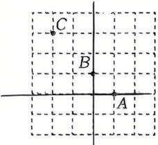

如图，在平面直角坐标系中，已知点 $A(1,0)$，$B(0,1)$，则图中点 C 的坐标是 \_\_\_.

> [!question]- 点击查看答案与解析
> 【答案】$(-1,-1)$
>
> 【考点】坐标系中点的坐标 → [[【初中数学知识点体系-人教版】#9-1 用坐标描述平面内点的位置]]
>
> 【解析】
> 由图可知，$A(1,0)$ 在 $x$ 轴正半轴，$B(0,1)$ 在 $y$ 轴正半轴。
> 根据坐标系中网格的对称性，点 $C$ 在第三象限，横坐标为 $-1$，纵坐标为 $-1$。
> 故 $C(-1,-1)$。
>
> 【易错点】横、纵坐标混淆；坐标轴正负方向判断错误。
