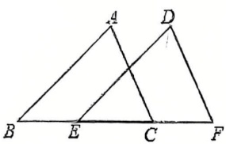

如图，$\triangle ABC$ 沿着 BC 所在直线的方向，向右平移到 $\triangle DEF$，已知 BC = 5，EC = 3，那么平移的距离为 \_\_\_。

> [!question]- 点击查看答案与解析
> 【答案】2
>
> 【考点】平移的性质 → [[【初中数学知识点体系-人教版】#7-4 平移]]
>
> 【解析】
> $\triangle ABC$ 沿 $BC$ 方向向右平移到 $\triangle DEF$。
> 由平移性质：$BE=CF=$ 平移距离，$BC=EF=5$。
> 由图可知 $E$ 在 $BC$ 上，$EC=3$，则 $BE=BC-EC=5-3=2$。
> 故平移距离为 $2$。
>
> 【易错点】误将 $EC$ 当作平移距离；线段和差关系判断错误。
