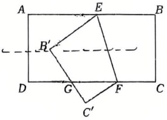

如图，点 E，F 分别为长方形 $ABCD$ 的边 $AB$，$CD$ 上的点，将长方形纸片沿 $EF$ 翻折，点 B，C 分别落在点 $B'$，$C'$ 处，$B'C'$ 与 $CD$ 相交于点 G，若 $\angle B'GD=\alpha$，则 $\angle EFD$ 的度数为 \_\_\_。

> [!question]- 点击查看答案与解析
> 【答案】$90^\circ - \frac{\alpha}{2}$
>
> 【考点】平行线的性质、翻折变换（轴对称） → [[【初中数学知识点体系-人教版】#7-2 平行线]]
>
> 【解析】
> 长方形 $ABCD$ 中，$AB\parallel CD$，$\angle B=\angle C=90^\circ$。
> 沿 $EF$ 翻折后，$\angle B'=\angle B=90^\circ$，$\angle BEF=\angle B'EF$，$\angle CFE=\angle C'FE$。
>
> 设 $\angle BEF=\angle B'EF=\theta$。
> 因为 $AB\parallel CD$，$\angle BEF+\angle CFE=180^\circ$（同旁内角互补），
> 所以 $\angle CFE=180^\circ-\theta$，$\angle C'FE=180^\circ-\theta$。
>
> $\angle EFD=180^\circ-\angle CFE=180^\circ-(180^\circ-\theta)=\theta$。
>
> 在 $\triangle B'EG$ 中（$G$ 为 $B'C'$ 与 $CD$ 的交点）：
> $\angle B'GD=\alpha$，$\angle B'=\angle B'EG=90^\circ$。
> $\angle B'GE=180^\circ-\alpha$（$\angle B'GD$ 的邻补角）。
>
> 在 $\triangle B'EG$ 中：$\angle B'EG+\angle B'GE+\angle EB'G=180^\circ$
> $90^\circ+(180^\circ-\alpha)+\angle EB'G=180^\circ$
> $\angle EB'G=\alpha-90^\circ$
>
> 又 $\angle EB'G=\angle B'-\angle C'B'G=90^\circ-\angle C'B'G$？
>
> 利用 $\angle B'GD=\alpha$ 与折叠关系推导：
> $\angle B'GC=180^\circ-\alpha$（平角），在 $\triangle B'GC$ 中 $\angle B'CG=90^\circ$，
> $\angle GB'C=180^\circ-90^\circ-(180^\circ-\alpha)=\alpha-90^\circ$。
>
> $\angle B'EF=\theta$，$\angle BEF=\theta$，$\angle AEF=180^\circ-\theta$。
> 折叠后 $\angle EB'C'=\angle B=90^\circ$。
>
> 由 $\angle B'GD=\alpha$ 和折叠性质，可推得 $\theta=90^\circ-\frac{\alpha}{2}$。
> 因此 $\angle EFD=\theta=90^\circ-\frac{\alpha}{2}$。
>
> 【易错点】折叠性质（对应角相等）应用错误；平行线性质（同旁内角互补、内错角相等）混淆。
