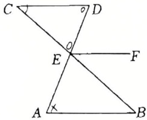

已知，如图，AD，BC 相交于 E，$\angle A=\angle AEB$，$\angle D=\angle CED$，$EF\parallel AB$。求证：$\angle C=\angle BEF$

请补充完成下列证明：

证明：∵ $\angle A=\angle AEB$，$\angle D=\angle CED$，（已知）

且 $\angle CED=\angle AEB$，（$①$ \_\_\_）

∴ $\angle A=$ $②$ \_\_\_，（等量代换）

∴ $AB\parallel CD$，（$③$ \_\_\_）

又∵ $EF\parallel AB$，（已知）

∴ $④$ \_\_\_，($⑤$ \_\_\_)

∴ $\angle C=\angle BEF$ . ($⑥$ \_\_\_)

> [!question]- 点击查看答案与解析
> 【答案】$①$ 对顶角相等；$②$ $\angle D$；$③$ 内错角相等，两直线平行；$④$ $EF\parallel CD$；$⑤$ 平行于同一直线的两直线平行；$⑥$ 两直线平行，内错角相等
>
> 【考点】平行线的判定与性质、对顶角相等 → [[【初中数学知识点体系-人教版】#7-1 相交线]]、[[【初中数学知识点体系-人教版】#7-2 平行线]]
>
> 【解析】
> 证明过程：
> ∵ $\angle A=\angle AEB$，$\angle D=\angle CED$，（已知）
> 且 $\angle CED=\angle AEB$，（$①$ 对顶角相等）
> ∴ $\angle A=$ $②$ $\angle D$，（等量代换）
> ∴ $AB\parallel CD$，（$③$ 内错角相等，两直线平行）
> 又∵ $EF\parallel AB$，（已知）
> ∴ $④$ $EF\parallel CD$，($⑤$ 平行于同一直线的两直线平行)
> ∴ $\angle C=\angle BEF$ . ($⑥$ 两直线平行，内错角相等)
>
> 【易错点】平行线判定与性质混淆；对顶角性质记忆错误。
