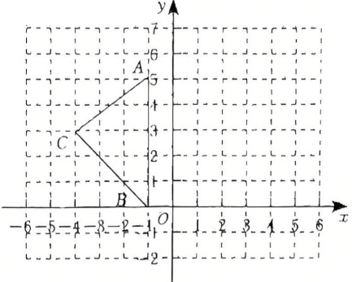

如图，在平面直角坐标系 xOy 中，$A(-1,5)$，$B(-1,0)$，$C(-4,3)$ .

(1) 在图中画出 $\triangle ABC$ 向右平移 4 个单位，再向下平移 2 个单位的 $\triangle A_{1}B_{1}C_{1}$

(2) 写出点 $A_{1}$，$B_{1}$，$C_{1}$ 的坐标：$A_{1} \_\_\_$，$B_{1} \_\_\_$，$C_{1} \_\_\_;$

(3) 设点 P 在 x 轴上，且 $\triangle BCP$ 与 $\triangle ABC$ 的面积相等，直接写出点 P 的坐标 \_\_\_ .

> [!question]- 点击查看答案与解析
> 【答案】(1) 图略；(2) $A_{1}(3,3)$，$B_{1}(3,-2)$，$C_{1}(0,1)$；(3) $P(2,0)$ 或 $P(-6,0)$
>
> 【考点】坐标与平移、三角形面积 → [[【初中数学知识点体系-人教版】#9-1 用坐标描述平面内点的位置]]、[[【初中数学知识点体系-人教版】#9-2 坐标方法的简单应用]]
>
> 【解析】
> (1) 向右平移 4 个单位：横坐标加 4；向下平移 2 个单位：纵坐标减 2。
>
> (2) $A(-1,5)\to A_{1}(-1+4,5-2)=(3,3)$
> $B(-1,0)\to B_{1}(-1+4,0-2)=(3,-2)$
> $C(-4,3)\to C_{1}(-4+4,3-2)=(0,1)$
>
> (3) $\triangle ABC$ 的面积：$A(-1,5),B(-1,0),C(-4,3)$。
> $AB=5$（竖直线段），$C$ 到 $AB$ 的距离为 $|-4-(-1)|=3$。
> $S_{\triangle ABC}=\frac{1}{2}\times5\times3=\frac{15}{2}$。
>
> $P$ 在 x 轴上，设 $P(x,0)$。$B(-1,0),C(-4,3)$。
> $\triangle BCP$ 的底 $BP=|x-(-1)|=|x+1|$，高为 $C$ 的纵坐标 $3$。
> $S_{\triangle BCP}=\frac{1}{2}\times|x+1|\times3=\frac{15}{2}$。
> $|x+1|=5$，$x+1=5$ 或 $x+1=-5$，$x=4$ 或 $x=-6$。
> 故 $P(4,0)$ 或 $P(-6,0)$。
>
> 【易错点】平移方向与坐标加减混淆；三角形高的确定错误；绝对值方程漏解。
