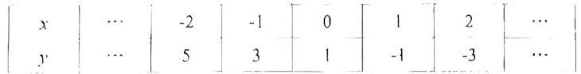
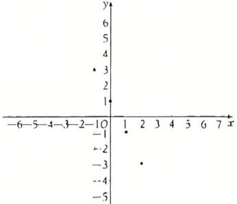
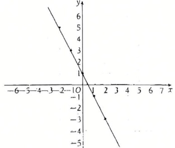
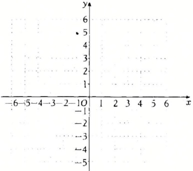

小明在探究二元一次方程 $2x+y=1$ 的图象时发现：可以将二元一次方程的解写成点的坐标的形式，如方程的解 $\begin{cases}x=-2\\y=5\end{cases}$ 写成点的坐标 $(-2,5)$，于是他就选取了二元一次方程 $2x+y=1$ 的一部分解，见下表，通过在平面直角坐标系中描点、连线，得到了二元一次方程 $2x+y=1$ 的图象。于是，他对二元一次方程的图象给出如下定义：以一个二元一次方程的解为坐标的点的全体叫作这个方程的图象，下面是二元一次方程 $2x+y=1$ 图象的画法：

步骤 1：列表

步骤 2：描点

步骤 3：连线

结论：二元一次方程的图象是一条直线，直线上点的坐标与二元一次方程的解一一对应。根据以上研究结论解决以下问题。

已知关于 x，y 的二元一次方程 $x+y=4$ 的部分解，如下表：

| x |  | -1 | 0 | 2 |
|---|---|---|---|---|
| y | 6 | 5 |  | 2 |

(1) $①$ 补全上表中的数；

$②$ 仿照示例的方法在平面直角坐标系中画出二元一次方程 $x+y=4$ 的图象；

(2) 若关于 x、y 的二元一次方程 $kx+y=2(k\neq0)$ 的图象与二元一次方程 $x+y=4$ 的图象交于点 $(-1,5)$，则 k = \_\_\_.

> [!question]- 点击查看答案与解析
> 【答案】(1) $①$ 表格补全：$x=3$ 时 $y=1$；$②$ 图略；(2) $k=3$
>
> 【考点】二元一次方程的图象、一元一次方程的解 → [[【初中数学知识点体系-人教版】#10-1 二元一次方程组的概念]]
>
> 【解析】
> (1) $①$ 方程 $x+y=4$，当 $x=3$ 时，$3+y=4$，$y=1$。
> 补全表格：$(3,1)$。
>
> (2) 两直线交于点 $(-1,5)$，说明该点同时满足两个方程。
> 代入 $kx+y=2$：$k\times(-1)+5=2$，$-k+5=2$，$k=3$。
>
> 【易错点】交点坐标代入错误；一元一次方程求解错误。
