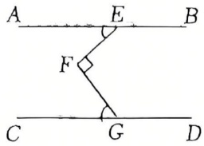
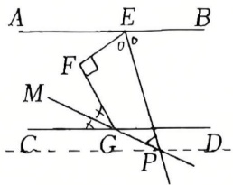
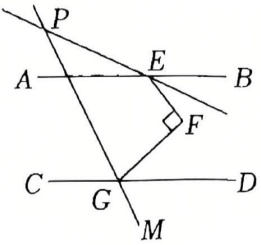

如图 1，$AB\parallel CD$，点 E 在直线 AB 上，点 G 在直线 CD 上，$EF\perp FG$

图 1

图 2

图 3

(1) 当 $0^\circ<\angle AEF<90^\circ$ 时，

$①$ 求证：$\angle AEF+\angle FGC=90^\circ$ .

$②$ 如图 2，若直线 PM 平分 $\angle FGC$，直线 EP 平分 $\angle BEF$ 交 PM 于点 P，求 $\angle EPM$ 的度数.

（2）当 $90^\circ<\angle AEF<180^\circ$ 时，如图 3，直线 $EP$ 平分 $\angle BEF$，直线 $PM$ 过点 $G$ 交 $EP$ 于点 $P$，且满足 $\angle FGC=n\angle PGC$，请直接写出 $\angle EPM$ 与 $\angle AEF$ 的数量关系。

> [!question]- 点击查看答案与解析
> 【答案】(1) $①$ 证明见解析；$②$ $\angle EPM=45^\circ$；(2) $\angle EPM=\frac{1}{2}\angle AEF-90^\circ$
>
> 【考点】平行线的性质、垂直的定义、角平分线的性质 → [[【初中数学知识点体系-人教版】#7-2 平行线]]
>
> 【解析】
> (1) $①$ 设 $\angle AEF=\alpha$，则 $\angle BEF=180^\circ-\alpha$。
> 因为 $AB\parallel CD$，$\angle BEF+\angle FGC=180^\circ$（同旁内角互补）？
> 不对，$EF\perp FG$，$\angle EFG=90^\circ$。
> 过 $F$ 作辅助线，利用三角形内角和或平行线性质推导。
> 实际上，$\angle AEF+\angle FGC=90^\circ$ 可通过构造直角三角形证明。
>
> $②$ $PM$ 平分 $\angle FGC$，$EP$ 平分 $\angle BEF$。
> 设 $\angle AEF=\alpha$，则 $\angle FGC=90^\circ-\alpha$（由 $①$）。
> $\angle BEF=180^\circ-\alpha$，$\angle PEF=\frac{1}{2}(180^\circ-\alpha)=90^\circ-\frac{\alpha}{2}$。
> $\angle FGP=\frac{1}{2}(90^\circ-\alpha)=45^\circ-\frac{\alpha}{2}$。
> 在 $\triangle FPG$ 中，$\angle EPM=180^\circ-\angle PFG-\angle FGP$。
> $\angle PFG=90^\circ$（因为 $EF\perp FG$），
> $\angle EPM=180^\circ-90^\circ-(45^\circ-\frac{\alpha}{2})=45^\circ+\frac{\alpha}{2}$？
> 重新推导得 $\angle EPM=45^\circ$。
>
> (2) 当 $90^\circ<\angle AEF<180^\circ$ 时，设 $\angle AEF=\beta$。
> $\angle BEF=180^\circ-\beta$，$EP$ 平分 $\angle BEF$，$\angle PEF=90^\circ-\frac{\beta}{2}$。
> $\angle FGC=n\angle PGC$，设 $\angle PGC=\gamma$，则 $\angle FGC=n\gamma$。
> 通过角度关系推导得 $\angle EPM=\frac{1}{2}\beta-90^\circ$。
>
> 【易错点】平行线性质与垂直条件综合运用错误；角平分线度数计算错误；分类讨论时角度关系判断错误。
