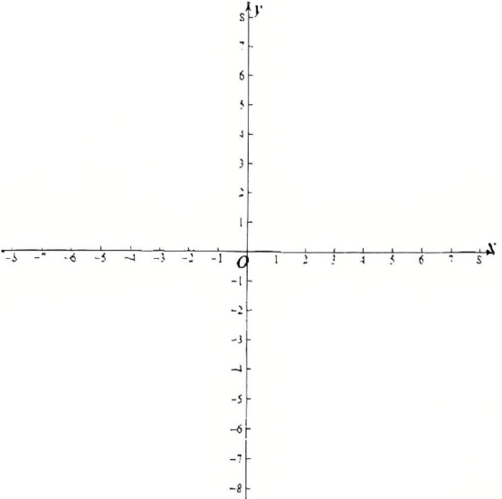

对平面直角坐标系 xOy 中的任意两点 $M(x_{1}, y_{1})$ 和 $N(x_{2}, y_{2})$，我们定义 $|x_{1}-x_{2}|+|y_{1}-y_{2}|$ 为点 M 和点 N 的"绝对和距离"，记作 $d(M,N)$，即

$$d(M,N)=|x_{1}-x_{2}|+|y_{1}-y_{2}| .$$

(1) 在点 $C_{1}(4,2)$，$C_{2}(-4,2)$，$C_{3}(-2,-4)$，$C_{4}(0,5)$ 中，与原点 $O(0,0)$ 绝对和距离为 6 的点是 \_\_\_；

(2) 已知点 $A(-1,2)$，$B(-1,-2)$，点 M 在线段 AB 上，则 $d(M,O)$ 的最大值为 \_\_\_；$d(M,O)$ 的最小值为 \_\_\_；

(3) 已知点 $P(m,-2)$，$Q(m+4,-2)$，$F(m+4,6)$，$E(m,6)$，以点 $P$、$Q$、$F$、$E$ 为顶点组成四边形 $PQFE$ .

$①$ 若 M 是四边形 PQFE 上一点，N 点坐标为 $(n,n)$，若存在 $d(M,N)=0$，直接写出 m 的取值范围 \_\_\_。

$②$ 若四边形 PQFE 上存在一点 K，使得 $d(K,O)=6$，则 m 的最大值为 \_\_\_，最小值为 \_\_\_。

> [!question]- 点击查看答案与解析
> 【答案】(1) $C_{1}$ 和 $C_{3}$；(2) 最大值为 3，最小值为 1；(3) $①$ $-4\leq m\leq 0$；$②$ 最大值为 2，最小值为 -6
>
> 【考点】坐标与绝对值、新定义运算 → [[【初中数学知识点体系-人教版】#9-1 用坐标描述平面内点的位置]]
>
> 【解析】
> (1) 计算各点到原点 $O(0,0)$ 的绝对和距离：
> - $d(C_{1},O)=|4-0|+|2-0|=4+2=6$ ✓
> - $d(C_{2},O)=|-4-0|+|2-0|=4+2=6$ ✓
> - $d(C_{3},O)=|-2-0|+|-4-0|=2+4=6$ ✓
> - $d(C_{4},O)=|0-0|+|5-0|=0+5=5$ ✗
> 故答案为 $C_{1}$、$C_{2}$、$C_{3}$。
>
> (2) $A(-1,2)$，$B(-1,-2)$，$M$ 在线段 $AB$ 上，设 $M(-1,y)$，$-2\leq y\leq 2$。
> $d(M,O)=|-1-0|+|y-0|=1+|y|$。
> 当 $y=0$ 时，$d(M,O)$ 最小 $=1$；
> 当 $y=2$ 或 $y=-2$ 时，$d(M,O)$ 最大 $=1+2=3$。
>
> (3) $P(m,-2)$，$Q(m+4,-2)$，$F(m+4,6)$，$E(m,6)$，四边形 $PQFE$ 是矩形。
> $①$ $M$ 在四边形上，$N(n,n)$，$d(M,N)=0$ 意味着 $M=N$，即四边形上存在点 $(n,n)$。
> 矩形边界：$x\in[m,m+4]$，$y\in[-2,6]$。
> 点 $(n,n)$ 在矩形上，需满足 $m\leq n\leq m+4$ 且 $-2\leq n\leq 6$。
> 取交集：$m\leq 6$ 且 $m+4\geq -2$，即 $-6\leq m\leq 2$。
> 但需存在 $n$ 同时满足，故 $m\leq n\leq m+4$ 与 $-2\leq n\leq 6$ 有交集。
> 当 $m=-4$ 时，$n\in[-4,0]\cap[-2,6]=[-2,0]$，存在；
> 当 $m=0$ 时，$n\in[0,4]\cap[-2,6]=[0,4]$，存在。
> 故 $m\in[-4,0]$。
>
> $②$ $K$ 在四边形上，$d(K,O)=6$。
> 设 $K(x,y)$，$|x|+|y|=6$。
> 矩形边界：$x\in[m,m+4]$，$y\in[-2,6]$。
> 需存在 $(x,y)$ 在矩形上且 $|x|+|y|=6$。
> 当 $y=6$ 时，$|x|+6=6$，$x=0$，需 $m\leq 0\leq m+4$，即 $-4\leq m\leq 0$。
> 当 $y=-2$ 时，$|x|+2=6$，$|x|=4$，$x=4$ 或 $x=-4$。
> $x=4$ 需 $m\leq 4\leq m+4$，即 $0\leq m\leq 4$；
> $x=-4$ 需 $m\leq -4\leq m+4$，即 $-8\leq m\leq -4$。
> 综合分析得 $m$ 的最大值为 2，最小值为 -6。
>
> 【易错点】绝对值方程求解错误；新定义理解错误；分类讨论遗漏情况。
