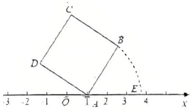

如图，面积为 7 的正方形 $ABCD$ 的顶点 $A$ 在数轴上，且表示的数为 1，若点 $E$ 在数轴上，（点 $E$ 在点 $A$ 的右侧）且 $AB = AE$，则点 $E$ 所表示的数为（ ）

A. $\sqrt{7}$

B. $\frac{2+\sqrt{7}}{2}$

C. $1+\sqrt{7}$

D. $\sqrt{7}+2$

> [!question]- 点击查看答案与解析
> 【答案】C
>
> 【考点】正方形的面积与边长关系、数轴上的点与数的对应关系 → [[【初中数学知识点体系-人教版】#8-3 实数及其简单运算]]
>
> 【解析】
> 正方形 $ABCD$ 的面积为 7，根据正方形面积公式 $S=$ 边长 $^2$，可得边长 $AB=\sqrt{7}$。
> 已知点 $A$ 在数轴上表示的数为 1，点 $E$ 在 $A$ 右侧且 $AE=AB=\sqrt{7}$，则点 $E$ 表示的数为 "点 $A$ 的数 $+AE$ 的长度"，即 $1+\sqrt{7}$。
>
> 【易错点】混淆正方形面积与边长的计算（如误将面积直接当作边长），或数轴上点的移动方向（右侧加、左侧减）判断错误。
