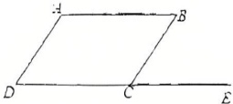

如图，在四边形 $ABCD$ 中，点 $E$ 在线段 $DC$ 的延长线上，能使直线 $AD \parallel BC$ 的条件有（ ）

(1) $\angle D = \angle BCE$，(2) $\angle B = \angle BCE$，(3) $\angle A + \angle B = 180^\circ$，(4) $\angle A + \angle D = 180^\circ$，(5) $\angle B = \angle D$

A. 1 个

B. 2 个

C. 3 个

D. 4 个

> [!question]- 点击查看答案与解析
> 【答案】A
>
> 【考点】平行线的判定定理（同位角、内错角、同旁内角） → [[【初中数学知识点体系-人教版】#7-2 平行线]]
>
> 【解析】
> 判定 $AD \parallel BC$ 需找到对应 "同位角相等、内错角相等、同旁内角互补" 的条件，逐一分析：
> - $①$ $\angle D = \angle BCE$：$\angle D$ 与 $\angle BCE$ 是同位角，同位角相等则 $AD \parallel BC$，此条件成立；
> - $②$ $\angle B = \angle BCE$：是判定 $AB \parallel CD$ 的内错角相等条件，与 $AD \parallel BC$ 无关，错误；
> - $③$ $\angle A + \angle B = 180^\circ$：是判定 $AB \parallel CD$ 的同旁内角互补条件，与 $AD \parallel BC$ 无关，错误；
> - $④$ $\angle A + \angle D = 180^\circ$：是判定 $AB \parallel CD$ 的同旁内角互补条件，与 $AD \parallel BC$ 无关，错误；
> - $⑤$ $\angle B = \angle D$：无直接平行线判定定理支持，无法判定 $AD \parallel BC$，错误。
> 
> 综上，只有条件 $①$ 成立，共 1 个。
>
> 【易错点】混淆平行线判定的截线与被截线，误将判定 $AB \parallel CD$ 的条件当作 $AD \parallel BC$ 的条件，或对同位角、内错角、同旁内角的位置识别错误。
