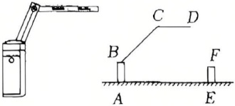

某小区车库门口的“曲臂直杆道闸”（如图）可抽象为如图所示模型．已知 AB 垂直于水平地面AE．当车牌被自动识别后，曲臂直杆道闸的 BC 段将绕点 B 缓慢向上抬高，CD 段则一直保持水平状态上升（即 CD 与 AE 始终平行），在该运动过程中 $\angle ABC+\angle BCD$ 的度数始终为（）

A. $270^{\circ}$

B. $250^{\circ}$

C. $230^{\circ}$

D. $180^{\circ}$

> [!question]- 点击查看答案与解析
> 【答案】A
>
> 【考点】平行线的性质、垂直的性质、角的和差计算 → [[【初中数学知识点体系-人教版】#7-2 平行线]]
>
> 【解析】
> 过点 $B$ 作 $BG \parallel CD$，因 $CD \parallel AE$、$AB \perp AE$，故 $AB \perp BG$（$\angle ABG=90^\circ$）。
> 由 $BG \parallel CD$，得 $\angle GBC + \angle BCD = 180^\circ$（同旁内角互补）。
> 因此 $\angle ABC + \angle BCD = \angle ABG + \angle GBC + \angle BCD = 90^\circ + 180^\circ = 270^\circ$。
>
> 【易错点】辅助线添加错误，或平行线性质与垂直的结合应用失误，角的拆分逻辑混乱。
