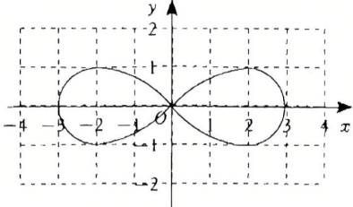

中国结是一种手工编织工艺品，因为其外观对称精致，可以代表汉族悠久的历史，符合中国传统装饰的习俗和审美观念，故命名为中国结，中国结的意义在于它所显示的精致与智慧正是汉族古老文明中的一个侧面，也是数学奥秘的游戏呈现，它有着复杂曼妙的曲线，却可以还原成最单纯的二维线条，其中的八字结对应着数学曲线中的双扭线在平面直角坐标系中如上图所示，则下列结论中正确的有（ ）

$①$ 双扭线围成的面积小于 6;

$②$ 双扭线内部（包含边界）包含11个整数点（横坐标、纵坐标都是整数的点）；

$③$ 双扭线上任意一点到原点的距离不超过 3；

$④$ 假设点 P 为双扭线上的一个点，A，B 为双扭线与 x 轴的交点（A 在 B 左边），则满足 $S_{\triangle PAB} = 3$ 的 P 点有 4 个.

A. $①②③$

B. $②③$

C. $②③④$

D. $①②③④$

## 二、填空题（每小题3分，共30分）

> [!question]- 点击查看答案与解析
> 【答案】C
>
> 【考点】平面直角坐标系中的面积估算、整数点识别、距离公式、三角形面积计算 → [[【初中数学知识点体系-人教版】#9-1 用坐标描述平面内点的位置]]
>
> 【解析】
> 逐一分析：
> $①$ 双扭线围成的面积小于 6：双扭线在边长为 $6\times2$ 的矩形内（面积 12），实际覆盖面积小于 12 但不一定小于 6，错误；
> $②$ 双扭线内部整数点：$(0,0)$、$(\pm1,0)$、$(\pm2,0)$、$(\pm3,0)$、$(\pm2,\pm1)$，共 11 个，正确；
> $③$ 双扭线上点到原点的距离 $\sqrt{x^2+y^2}\leq\sqrt{2^2+2^2}=\sqrt{8}<3$，正确；
> $④$ $S_{\triangle PAB}=3$，则三角形底 $\times$ 高 $=6$，因为 $A,B$ 都在 $x$ 轴上，所以 $AB=6$，因此三角形的高是 1。双扭线纵向最大 $y=\pm1$，满足条件的点有 4 个，正确。
> 
> 综上，$②③④$ 正确。
>
> 【易错点】整数点计数遗漏 / 重复，三角形面积公式中底和高的对应关系错误。
