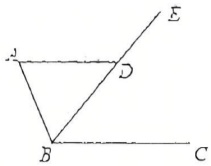

如图，AD // BC，点 E 在 BD 的延长线上，若 $\angle ADE = 130^\circ$，则 $\angle DBC$ 的度数为 ___ .

> [!question]- 点击查看答案与解析
> 【答案】$50^\circ$
>
> 【考点】邻补角的性质、平行线的性质（内错角相等） → [[【初中数学知识点体系-人教版】#7-1 相交线]]
>
> 【解析】
> $\angle ADE=130^\circ$，其邻补角 $\angle ADB=50^\circ$；由 $AD \parallel BC$，得 $\angle DBC=\angle ADB=50^\circ$。
>
> 【易错点】邻补角的和计算错误，平行线内错角识别错误。
