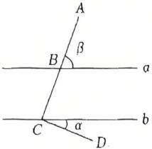

如图，直线 $a \parallel b$，$AC$ 分别交直线 $a$、$b$ 于点 $B$、$C$，$AC \perp DC$，若 $\angle \alpha = 25^\circ$，那么 $\angle \beta =$ ___ 。

> [!question]- 点击查看答案与解析
> 【答案】$65^\circ$
>
> 【考点】平行线的性质（同位角相等）、垂直的性质 → [[【初中数学知识点体系-人教版】#7-2 平行线]]
>
> 【解析】
> 由 $a \parallel b$ 得 $\angle \alpha$ 的同位角为 $25^\circ$；由 $AC \perp DC$，得 $\angle \beta=90^\circ-25^\circ=65^\circ$。
>
> 【易错点】平行线同位角识别错误，垂直的直角性质应用错误。
