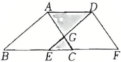

如图，在三角形 ABC 中，$\angle BAC = 90^\circ$，$AB = 4cm$，$BC = 5cm$，$AC = 3cm$，将三角形 ABC 沿 BC 方向平移 $a$ cm ($a < 5$) 得到三角形 DEF，且 AC 与 DE 相交于点 G，连接 AD，则阴影部分的周长为 ___ cm。

> [!question]- 点击查看答案与解析
> 【答案】12
>
> 【考点】平移的性质、三角形周长计算 → [[【初中数学知识点体系-人教版】#7-4 平移]]
>
> 【解析】
> 平移后阴影部分周长等于 $AD + EC + AC + DE$，等价于 $BC + AC + AB$（平移不改变线段长度，阴影边可拼接为直角边），即 $5+4+3=12$。
>
> 【易错点】平移性质理解错误，阴影部分边拆分错误。
