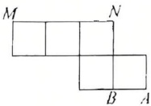

如图，将 5 个大小相同的正方形置于平面直角坐标系中，若顶点 M、N 的坐标分别为 $(-3,2)$、$(9,2)$，则顶点 A 的坐标为 ___ 。

> [!question]- 点击查看答案与解析
> 【答案】$(13,-6)$
>
> 【考点】平面直角坐标系中正方形的边长计算、点的坐标推导 → [[【初中数学知识点体系-人教版】#9-2 坐标方法的简单应用]]
>
> 【解析】
> $M(-3,2)$、$N(9,2)$ 间距 12，对应 3 个正方形边长，故边长为 4；顶点 $A$ 横坐标 $9+4=13$，纵坐标 $2-8=-6$，即 $A(13,-6)$。
>
> 【易错点】正方形边长计算错误，坐标推导时纵向平移方向错误。
