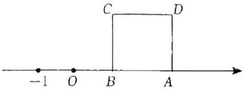

如图，面积为 $a (a > 1)$ 的正方形 $ABCD$ 的边 $AB$ 在数轴上，点 $B$ 表示的数为 1，将正方形 $ABCD$ 沿着数轴水平移动，移动后的正方形记为 $A'B'C'D'$，点 $A$、$B$、$C$、$D$ 的对应点分别为 $A'$、$B'$、$C'$、$D'$，移动后的正方形 $A'B'C'D'$ 与原正方形 $ABCD$ 重叠部分图形的面积记为 $S$。当 $S = \sqrt{a}$ 时，数轴上点 $B'$ 表示的数是 ___ （用含 $a$ 的代数式表示）.

## 三、解答题（共54分）

> [!question]- 点击查看答案与解析
> 【答案】$\sqrt{a}$ 或 $2 - \sqrt{a}$
>
> 【考点】正方形的面积与边长、平移的性质、重叠面积计算 → [[【初中数学知识点体系-人教版】#7-4 平移]]
>
> 【解析】
> 正方形边长为 $\sqrt{a}$，重叠面积 $S=\sqrt{a}$，则重叠边长为 1。
> - 向右平移：$B'$ 表示的数为 $1 + (\sqrt{a}-1)=\sqrt{a}$；
> - 向左平移：$B'$ 表示的数为 $1 - (\sqrt{a}-1)=2 - \sqrt{a}$。
>
> 【易错点】平移方向考虑不全，重叠面积的边长计算错误。
