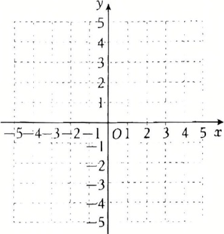

已知三角形 $A^{\prime}B^{\prime}C^{\prime}$ 是由三角形 ABC 经过平移得到的，它们各顶点在平面直角坐标系中的坐标如表所示：

| 三角形ABC | A(a,-2) | B(0,-2) | C(1,2) |
|---|---|---|---|
| 三角形A&#x27;B&#x27;C&#x27; | A&#x27;(1,-1) | B&#x27;(4,b) | C&#x27;(c,3) |

(1) 观察表中各对应点坐标的变化，并填空：a=___ ，b=___ ，c=___ ；

(2) 在平面直角坐标系 $xOy$ 中画出三角形 ABC 和三角形 $A^{\prime}B^{\prime}C^{\prime}$;

(3) 三角形 $A^{\prime}B^{\prime}C^{\prime}$ 的面积为 ___ ；

(4) 若 y 轴上点 P 满足三角形 $A^{\prime}B^{\prime}P$ 的面积等于三角形 ABC 的面积，则点 P 的坐标是 ___ .

> [!question]- 点击查看答案与解析
> 【答案】(1) $a=-3$，$b=-1$，$c=5$；(2) 画图见解析；(3) 6；(4) $(0, 3)$ 或 $(0, -5)$
>
> 【考点】点的平移规律、三角形面积计算、坐标系画图 → [[【初中数学知识点体系-人教版】#9-2 坐标方法的简单应用]]
>
> 【解析】
> (1) 平移规律：由 B 和 B' 横坐标变化，C 和 C' 纵坐标变化，横坐标 $+4$，纵坐标 $+1$（由 $B(0,-2)\to B'(4,b)$ 得 $b=-1$；$A(a,-2)\to A'(1,-1)$ 得 $a=-3$；$C(1,2)\to C'(c,3)$ 得 $c=5$）。
> 
> (2) 三角形 $ABC$：连接 $A(-3,-2)$、$B(0,-2)$、$C(1,2)$；三角形 $A'B'C'$：连接 $A'(1,-1)$、$B'(4,-1)$、$C'(5,3)$（画图略）。
> 
> (3) $\triangle ABC$ 的底 $AB=3$，高为 4，面积 $=\frac{1}{2}\times3\times4=6$（平移不改变面积）。
> 
> (4) 设 $P(0,y)$，$\triangle A'B'P$ 底 $A'B'=3$，高 $|y+1|$，由 $\frac{1}{2}\times3\times|y+1|=6$ 得 $|y+1|=4$，解得 $y=3$ 或 $y=-5$。
>
> 【易错点】平移规律总结错误，三角形高的定义理解错误。
