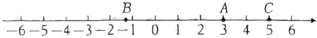

如图，数轴上点 A 所表示的数为 3，老鼠在点 A 处发现猫在其左侧距离 $1+\sqrt{10}$ 个单位长度的点 B，设点 B 所表示的数为 m。

(1) m = ___ .

(2) 老鼠发现猫沿数轴向右运动来抓自己，它立刻沿数轴往老鼠洞 C 的方向逃跑，点 C 所表示的数为 5，则 $BC =$ ___ 。若老鼠的速度是 1 个单位长度 / 秒，猫的速度为 $2\sqrt{2}$ 个单位长度 / 秒，则老鼠从 A 到达 C 时，猫运动的路程是 ___ ，老鼠 ___ （填“能”或“不能”）逃脱猫的魔爪。

> [!question]- 点击查看答案与解析
> 【答案】(1) $2 - \sqrt{10}$；(2) $3 + \sqrt{10}$；$4\sqrt{2}$；能
>
> 【考点】数轴上的点与数的关系、两点间距离、路程公式 → [[【初中数学知识点体系-人教版】#8-3 实数及其简单运算]]
>
> 【解析】
> (1) 点 $B$ 表示的数 $m=3 - (1+\sqrt{10})=2 - \sqrt{10}$。
> 
> (2) $BC=5 - (2 - \sqrt{10})=3 + \sqrt{10}$；
> 老鼠从 $A$ 到 $C$ 的时间 $=(5-3)\div1=2$ 秒，猫的路程 $=2\sqrt{2}\times2=4\sqrt{2}$；
> 猫到 $C$ 的距离 $3+\sqrt{10}\approx6.16$，猫走的路程 $4\sqrt{2}\approx5.66<6.16$，老鼠能逃脱。
>
> 【易错点】数轴上距离计算错误，无理数估算错误。
