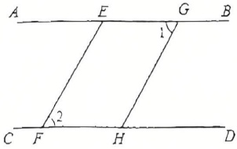
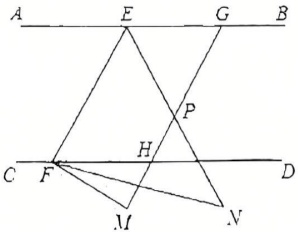
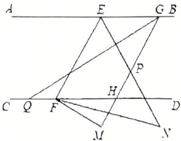

已知：$AB \parallel CD$，E、G 是 AB 上的点，F、H 是 CD 上的点，$\angle1 = \angle2$

图1 

图2 

图3 

(1) 如图 1，求证：$EF//GH$；

(2) 如图 2，过 F 点作 $FM \perp GH$ 交 GH 延长线于点 M，作 $\angle BEF$、$\angle DFM$ 的角平分线交于点 N，EN 交 GH 于点 P，求证：$\angle N = 45^\circ$；

(3) 如图 3，在 (2) 的条件下，作 $\angle AGH$ 的角平分线交 CD 于点 Q，若 $3 \angle FEN = 4 \angle HFM$，直接写出 $\frac{\angle GQH}{\angle MPN}$ 的值.

> [!question]- 点击查看答案与解析
> 【答案】(1) 证明见解析；(2) 证明见解析；(3) $\frac{1}{4}$
>
> 【考点】平行线的判定与性质、角平分线定义、垂直的性质 → [[【初中数学知识点体系-人教版】#7-2 平行线]]
>
> 【解析】
> (1) 已知 $AB \parallel CD$，根据两直线平行，内错角相等，得 $\angle1=\angle EFD$。
> 又 $\angle1=\angle2$，等量代换得 $\angle2=\angle EFD$。
> 根据内错角相等，两直线平行，可证 $EF \parallel GH$。
> 
> (2) 由 (1) 得 $EF \parallel GH$，又 $FM \perp GH$，根据平行线的传递性，得 $FM \perp EF$，即 $\angle EFM=90^\circ$。
> 设 $\angle BEN=\angle NEF=x$，$\angle DFN=\angle NFM=y$。
> 结合平行线性质与角度互补关系，推导得 $2x+\angle EFD=180^\circ$，$2y+\angle EFD=90^\circ$，即 $x-y=45^\circ$。
> 又因为 $x+y+\angle N+\angle EFD=180^\circ$，所以 $2x=x+y+\angle N$，即 $\angle N=x-y=45^\circ$，得证。
> 
> (3) 由 $AB \parallel CD$，则 $\angle GQH = \angle EGQ = \frac{1}{2}\angle AGH$。
> 由 $EF \parallel GH$，则 $\angle BEF + \angle AGH = 180^\circ$，即 $\angle FEN + \angle EGQ = 90^\circ$，$\angle MPN = \angle FEN$。
> 由 $AB \parallel CD$，则 $\angle AGH = \angle FHM$。在三角形 $FHM$ 中，$\angle HFM + \angle FHM = 90^\circ$。
> 所以 $\angle FEN + \angle EGQ = 90^\circ = \angle HFM + \angle FHM$。
> 即 $\angle MPN + \angle GQH = \frac{3}{4}\angle MPN + 2\angle GQH$
> 得到：$\frac{\angle GQH}{\angle MPN} = \frac{1}{4}$
>
> 【易错点】复杂图形角度关系梳理混乱，角平分线等分角度遗漏，多步推导中等量代换出错，无法建立角度参数关系。
