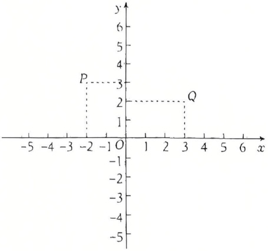
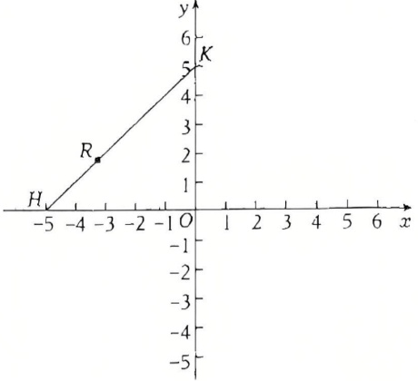

对于平面直角坐标系中的任意两点 P，Q，若点 P 到两坐标轴的距离之和等于点 Q 到两坐标轴的距离之和，则称 P，Q 两点为“和合点”，如图 1 中的 P，Q 两点即为“和合点”.

图1 

图2 

(1) 已知点 $A(-4,8)$，$B(6,0)$，$C(6,6)$，$D(-2,9)$.

$①$ 在上面四点中，与点 $E(-5,-7)$ 为 “和合点” 的是 ___ ；

$②$ 若点 $F(-3,0)$，过点 $F$ 作直线 $l \perp x$ 轴，点 $G$ 在直线 $l$ 上，$A$、$G$ 两点为 “和合点”，则点 $G$ 的坐标为___ ；

$③$ 若点 $M(3a,3)$ 在第二象限，点 $N(-2a,-b)$ 在第四象限，且 $A、M$ 两点为 “和合点”， $D、N$ 两点为 “和合点”，求 $a, b$ 的值.

(2) 如图 2，已知点 $H(-5,0)$，$K(0,5)$，点 $R(x,y)$ 是线段 HK 上的一动点，且满足 $x-y=-5$，过点 $T(n,0)$ 作直线 $m\perp x$ 轴，若在直线 m 上存在点 S，使得 R，S 两点为“和合点”，直接写出 n 的最大值.

> [!question]- 点击查看答案与解析
> 【答案】(1) $①$ $A$、$C$；$②$ $(-3,9)$ 或 $(-3,-9)$；$③$ $a=-3$，$b=5$；(2) $5$
>
> 【考点】新定义 "和合点"、点到坐标轴距离、象限坐标特征、动点最值问题 → [[【初中数学知识点体系-人教版】#9-1 用坐标描述平面内点的位置]]
>
> 【解析】
> 新定义：两点为 "和合点"，即两点到两坐标轴的距离之和相等，坐标距离和公式：$|x|+|y|$。
> 
> (1) $①$ 计算点 $E(-5,-7)$ 距离和：$|-5|+|-7|=12$。分别计算各点：$A(-4,8):4+8=12$，$B(6,0):6+0=6$，$C(6,6):6+6=12$，$D(-2,9):2+9=11$。因此与 $E$ 为和合点的是 $A$、$C$。
> 
> $②$ 直线 $l\perp x$ 轴且过 $F(-3,0)$，则 $G$ 点横坐标为 $-3$。$A$ 点距离和为 12，故 $|-3|+|y|=12$，解得 $|y|=9$，即 $y=\pm9$。因此 $G$ 点坐标为 $(-3,9)$、$(-3,-9)$。
> 
> $③$ 点 $M(3a,3)$ 在第二象限，故 $3a<0$，即 $a<0$。$A$、$M$ 为和合点：$|3a|+3=12$，解得 $|3a|=9$，结合 $a<0$ 得 $a=-3$。点 $N(-2a,-b)$ 在第四象限，代入 $a=-3$ 得 $N(6,-b)$，故 $-b<0$，$b>0$。$D$、$N$ 为和合点，$D$ 距离和为 11，故 $|6|+|-b|=11$，解得 $b=5$。
> 
> (2) 已知点 $H(-5,0)$ 和 $K(0,5)$，线段 $HK$ 所在直线方程为 $y=x+5$（$-5\leq x\leq 0$）。
> 点 $R(x,x+5)$ 到两坐标轴的距离之和为 $|x|+|x+5|=-x+(x+5)=5$。
> 直线 $m$ 过点 $T(n,0)$ 且垂直于 $x$ 轴，方程为 $x=n$。设 $S(n,y_S)$，由 "和合点" 条件：$|n|+|y_S|=5$。
> 要使 $S$ 存在，需 $|n|\leq 5$，即 $n$ 的最大值为 5。
>
> 【易错点】新定义距离和理解偏差，象限坐标符号判断错误，动点最值范围分析不全面，漏解多情况题型。
