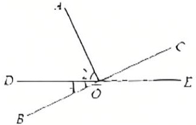

如图，直线 DE 与 BC 相交于点 O，$\angle 1$ 与 $\angle 2$ 互余， $\angle AOE = 116^{\circ}$，则 $\angle BOE$ 的度数为（ ）

第 2 题

A.  $144^{\circ}$

B.  $164^{\circ}$

C.  $154^{\circ}$

D.  $150^{\circ}$

> [!question]- 点击查看答案与解析
> 【答案】C
> 
> 【考点】角的计算、互余关系 → [[【初中数学知识点体系-人教版】#7-1 相交线]]
> 
> 【解析】
> $\angle AOE=116^{\circ}$，$\angle AOE$与$\angle 2$是邻补角，所以$\angle 2=180^{\circ}-116^{\circ}=64^{\circ}$。
> $\angle 1$与$\angle 2$互余，所以$\angle 1=90^{\circ}-64^{\circ}=26^{\circ}$。
> $\angle BOE=180^{\circ}-\angle 1=180^{\circ}-26^{\circ}=154^{\circ}$。
> 
> 故选C。
> 
> 【易错点】利用互余和邻补角的关系逐步求解。
