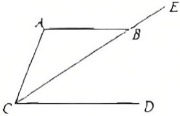

如图，已知 $AB // CD$，CE 平分 $\angle ACD$，交 AB 于点 B，$\angle ABE = 150^{\circ}$，则 $\angle A$ 为（ ）

第 3 题

A.  $110^{\circ}$

B.  $120^{\circ}$

C.  $135^{\circ}$

D.  $150^{\circ}$

> [!question]- 点击查看答案与解析
> 【答案】B
> 
> 【考点】平行线的性质、角平分线 → [[【初中数学知识点体系-人教版】#7-2 平行线]]
> 
> 【解析】
> $\angle ABE=150^{\circ}$，所以$\angle ABC=180^{\circ}-150^{\circ}=30^{\circ}$（邻补角）。
> 因为$AB\parallel CD$，所以$\angle ABC=\angle BCD=30^{\circ}$（两直线平行，内错角相等）。
> 因为CE平分$\angle ACD$，所以$\angle ACD=2\angle BCD=60^{\circ}$。
> 因为$AB\parallel CD$，所以$\angle A+\angle ACD=180^{\circ}$（两直线平行，同旁内角互补）。
> $\angle A=180^{\circ}-60^{\circ}=120^{\circ}$。
> 
> 故选B。
> 
> 【易错点】综合利用角平分线和平行线的性质逐步推导。
