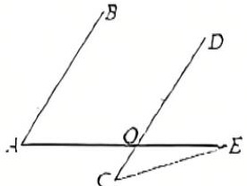

如图，已知 AE 交 CD 于点 O，$AB // CD$，$\angle A = 50^{\circ}$，$\angle E = 15^{\circ}$，则 $\angle C$ 的度数为（ ）

第 4 题

A.  $50^{\circ}$

B.  $65^{\circ}$

C.  $35^{\circ}$

D.  $15^{\circ}$

> [!question]- 点击查看答案与解析
> 【答案】C
> 
> 【考点】平行线的性质、三角形外角 → [[【初中数学知识点体系-人教版】#7-2 平行线]]
> 
> 【解析】
> 因为$AB\parallel CD$，所以$\angle A=\angle DOE=50^{\circ}$（两直线平行，同位角相等）。
> 在$\triangle COE$中，$\angle DOE$是外角，$\angle DOE=\angle C+\angle E$。
> 所以$\angle C=\angle DOE-\angle E=50^{\circ}-15^{\circ}=35^{\circ}$。
> 
> 故选C。
> 
> 【易错点】利用平行线性质将角转化，再用三角形外角性质求解。
