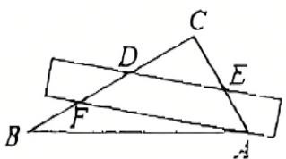

将一把直尺和一块含 $30^{\circ}$ 角的三角板 ABC 按如图所示的位置放置，如果 $\angle CED = 46^{\circ}$，那么 $\angle BAF$ 的度数为（ ）

第 5 题

A.  $48^{\circ}$

B.  $16^{\circ}$

C.  $14^{\circ}$

D.  $32^{\circ}$

> [!question]- 点击查看答案与解析
> 【答案】C
> 
> 【考点】平行线的性质、三角尺角度 → [[【初中数学知识点体系-人教版】#7-2 平行线]]
> 
> 【解析】
> 三角尺ABC中，$\angle C=90^{\circ}$，$\angle BAC=30^{\circ}$。
> 
> 因为直尺的两边$DE\parallel AF$，所以$\angle CED=\angle CFA=46^{\circ}$（两直线平行，同位角相等）。
> 
> 在$\triangle ACF$中，$\angle C=90^{\circ}$，$\angle CFA=46^{\circ}$。
> $\angle CAF=180^{\circ}-90^{\circ}-46^{\circ}=44^{\circ}$。
> 
> $\angle BAF=\angle CAF-\angle BAC=44^{\circ}-30^{\circ}=14^{\circ}$。
> 
> 故选C。
> 
> 【易错点】利用直尺两边平行的性质和三角尺的特殊角度，正确识别角的位置关系。
