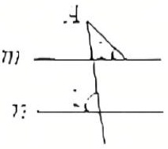
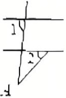
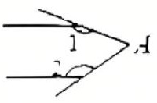
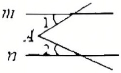

下列各图形中均有直线 $m // n$，则能使结论 $\angle A = \angle 1 - \angle 2$ 成立的是（ ）

A

B

C

D

> [!question]- 点击查看答案与解析
> 【答案】B
> 
> 【考点】平行线的性质、折线角关系 → [[【初中数学知识点体系-人教版】#7-2 平行线]]
> 
> 【解析】
> 分析各选项中$\angle A$与$\angle 1$、$\angle 2$的关系：
> 
> 选项B的图形：过点A作$m$的平行线，将$\angle A$分成两个角。
> 由平行线性质，$\angle 1$是外角，$\angle A=\angle 1-\angle 2$。
> 
> 具体来说，选项B中，$\angle 1$是上方截线形成的角，$\angle 2$是下方截线形成的角。
> 利用平行线的性质和三角形外角定理，可得$\angle A=\angle 1-\angle 2$。
> 
> 故选B。
> 
> 【易错点】作辅助平行线，利用平行线性质建立角的关系。
