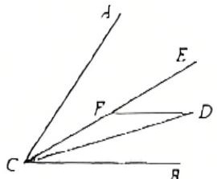

如图，$\angle BCA=64^\circ$，CE 平分 $\angle ACB$，CD 平分 $\angle ECB$，$DF // BC$ 交 CE 于点 F，则 $\angle CDF$ 的度数为 $\_\_\_\_\_$

第 9 题

> [!question]- 点击查看答案与解析
> 【答案】$16^{\circ}$
> 
> 【考点】角平分线、平行线的性质 → [[【初中数学知识点体系-人教版】#7-2 平行线]]
> 
> 【解析】
> $\angle BCA=64^{\circ}$，CE平分$\angle ACB$，所以$\angle ACE=\angle ECB=32^{\circ}$。
> CD平分$\angle ECB$，所以$\angle ECD=\angle DCB=16^{\circ}$。
> 因为$DF\parallel BC$，所以$\angle CDF=\angle DCB=16^{\circ}$（两直线平行，内错角相等）。
> 
> 【易错点】多次运用角平分线的定义和平行线的性质。
