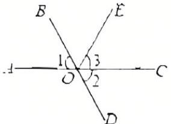

如图，直线 AC 和直线 BD 相交于点 O，OE 平分 $\angle BOC$，若 $\angle 1 + \angle 2 = 80^{\circ}$，则 $\angle 3$ 的度数为 $\_\_\_\_\_ ^{\circ}$

第 10 题

> [!question]- 点击查看答案与解析
> 【答案】$50$
>
> 【考点】角平分线、对顶角、邻补角 → [[【初中数学知识点体系-人教版】#7-1 相交线]]
>
> 【解析】
> 设$\angle 1=x$，因为OE平分$\angle BOC$，所以$\angle BOE=\angle COE=x$。
> $\angle BOC=2x$。
>
> 由图可知$\angle 2$与$\angle 1$互不重叠，且$\angle 1+\angle 2=80^{\circ}$。
>
> $\angle 3$与$\angle BOC$是对顶角，所以$\angle 3=\angle BOC=2x$。
> $\angle 2$与$\angle BOC$是邻补角，所以$\angle 2=180^{\circ}-2x$。
>
> 代入$\angle 1+\angle 2=80^{\circ}$：
> $x+(180^{\circ}-2x)=80^{\circ}$。
> $180^{\circ}-x=80^{\circ}$。
> $x=25^{\circ}$。
>
> 所以$\angle 3=2x=50^{\circ}$。
>
> 【易错点】理解图形中各个角的位置关系，正确应用对顶角和邻补角的性质。
