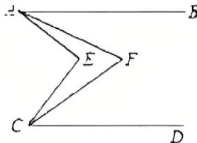

如图： $AB // CD$"，$AE \perp CE$，$\angle EAF = \frac{1}{3} \angle EAB$，$\angle ECF = \frac{1}{3} \angle ECD$，则 $\angle AFC = \_\_\_\_\_$。

第 11 题

> [!question]- 点击查看答案与解析
> 【答案】$60^{\circ}$
> 
> 【考点】平行线的性质、比例关系 → [[【初中数学知识点体系-人教版】#7-2 平行线]]
> 
> 【解析】
> 因为$AB\parallel CD$，$AE\perp CE$，所以$\angle AEC=90^{\circ}$。
> 
> 设$\angle EAB=\alpha$，$\angle ECD=\beta$。
> 
> 过E作$EG\parallel AB$，则$EG\parallel CD$。
> $\angle AEG=180^{\circ}-\alpha$（同旁内角）。
> $\angle CEG=180^{\circ}-\beta$（同旁内角）。
> 
> $\angle AEC=|\angle AEG-\angle CEG|=|(180^{\circ}-\alpha)-(180^{\circ}-\beta)|=|\beta-\alpha|=90^{\circ}$。
> 
> 由$\angle EAF=\frac{1}{3}\angle EAB$，得$\angle FAB=\frac{2}{3}\alpha$。
> 由$\angle ECF=\frac{1}{3}\angle ECD$，得$\angle FCD=\frac{2}{3}\beta$。
> 
> 过F作$FH\parallel AB$，则$FH\parallel CD$。
> $\angle AFH=\angle FAB=\frac{2}{3}\alpha$（内错角）。
> $\angle CFH=\angle FCD=\frac{2}{3}\beta$（内错角）。
> 
> 在$\triangle AFC$中：
> $\angle AFC=180^{\circ}-\angle FAC-\angle FCA=180^{\circ}-\frac{2}{3}\alpha-\frac{2}{3}\beta=180^{\circ}-\frac{2}{3}(\alpha+\beta)$。
> 
> 由$\alpha+\beta=180^{\circ}$（折线角关系）和$|\beta-\alpha|=90^{\circ}$，联立解得：
> $\beta-\alpha=90^{\circ}$，$\alpha+\beta=180^{\circ}$。
> $2\beta=270^{\circ}$，$\beta=135^{\circ}$。
> $\alpha=45^{\circ}$。
> 
> $\angle AFC=180^{\circ}-\frac{2}{3}(180^{\circ})=180^{\circ}-120^{\circ}=60^{\circ}$。
> 
> 【易错点】利用平行线性质和比例关系推导角的关系，正确建立角度方程。
