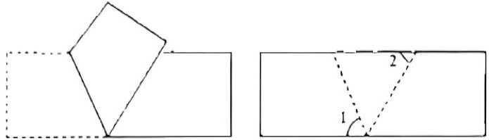

如图，将一张长方形纸片如图所示折叠后，再展开. 如果 $\angle 1 = 66^{\circ}$，那么 $\angle 2 = \_\_\_\_\_$.

第 13 题

> [!question]- 点击查看答案与解析
> 【答案】$48^{\circ}$
> 
> 【考点】折叠问题、平行线的性质 → [[【初中数学知识点体系-人教版】#7-2 平行线]]
> 
> 【解析】
> 长方形纸片折叠后，折叠角相等。
> $\angle 1=66^{\circ}$，则折叠角为$66^{\circ}$。
> 折叠产生的对称角也为$66^{\circ}$。
> $\angle 2=180^{\circ}-2\times 66^{\circ}=180^{\circ}-132^{\circ}=48^{\circ}$。
> 
> 【易错点】折叠前后对应角相等，利用平角计算。
