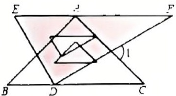

一副三角板按如图所示的方式放置，它们的直角顶点 A，D 分别在另一个三角板的斜边上，且 $EF // BC$，则 $\angle 1$ 的度数为 $\_\_\_\_\_$.

第 14 题

> [!question]- 点击查看答案与解析
> 【答案】$75^{\circ}$
>
> 【考点】平行线的性质、三角尺角度 → [[【初中数学知识点体系-人教版】#7-2 平行线]]
>
> 【解析】
> 一副三角板：一个是$45^{\circ}-45^{\circ}-90^{\circ}$，另一个是$30^{\circ}-60^{\circ}-90^{\circ}$。
> 因为$EF\parallel BC$，利用平行线性质。
> $\angle 1$是由两个三角板形成的角。
> $\angle 1=45^{\circ}+30^{\circ}=75^{\circ}$（两三角板的锐角之和）。
>
> 【易错点】熟悉三角尺的角度，利用平行线性质转化角。
