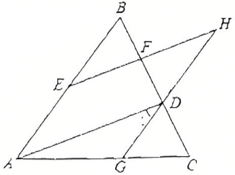

如图，在 $\triangle ABC$ 中，点 D、F 在 BC 边上，点 E 在 AB 边上，点 G 在 AC 边上，EF 与 GD 的延长线交于点 H，$\angle CDF = \angle B$，$\angle 1 + \angle FEA = 180^{\circ}$

求证：
(1) $EH//AD$

(2) $\angle BAD = \angle H$

> [!question]- 点击查看答案与解析
> 【答案】见解析
> 
> 【考点】平行线的判定与性质 → [[【初中数学知识点体系-人教版】#7-2 平行线]]
> 
> 【解析】
> 
> (1) 证明$EH\parallel AD$：
> 
> $\angle 1+\angle FEA=180^{\circ}$（已知）。
> $\angle 1$与$\angle FEA$是同旁内角。
> 所以$EH\parallel AD$（同旁内角互补，两直线平行）。
> 
> (2) 证明$\angle BAD=\angle H$：
> 
> 由(1)知$EH\parallel AD$。
> $\angle H=\angle ADG$（两直线平行，内错角相等）。
> 
> $\angle CDF=\angle B$（已知）。
> 所以$DF\parallel AB$（同位角相等，两直线平行）。
> 
> $\angle ADG=\angle BAD$（两直线平行，内错角相等）。
> 
> 所以$\angle H=\angle BAD$（等量代换）。
> 
> 【易错点】综合利用平行线的判定和性质进行推理。
