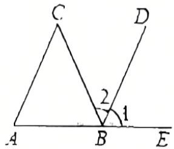

如图，$BD // AC$，点 E 在线段 AB 的延长线上， $\angle 1 = 38^\circ, \angle C = 75^\circ$，则  $\angle ABC$ 的度数是 $\_\_\_\_\_$。

第 2 题

> [!question]- 点击查看答案与解析
> 【答案】$67^\circ$
> 
> 【考点】平行线的性质、三角形内角和定理 → [[【初中数学知识点体系-人教版】#7-2 平行线]]
> 
> 【解析】
> $\because BD // AC$（已知）
> 
> $\therefore \angle A = \angle 1 = 38^\circ$（两直线平行，同位角相等）
> 
> 在 $\triangle ABC$ 中，根据三角形内角和定理：
> 
> $\angle ABC + \angle A + \angle C = 180^\circ$
> 
> $\therefore \angle ABC = 180^\circ - \angle A - \angle C = 180^\circ - 38^\circ - 75^\circ = 67^\circ$
> 
> 【易错点】不能正确识别同位角，或者忘记三角形内角和为 $180^\circ$。
