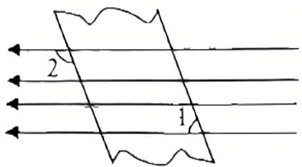

如图，在一束平行光线中插入一张对边平行的纸板．如果图中 $\angle 1$ 是 $70^\circ$，那么 $\angle 2$ 的度数是 $\_\_\_\_\_$．

第 3 题

> [!question]- 点击查看答案与解析
> 【答案】$110^\circ$
> 
> 【考点】平行线的性质、同旁内角互补 → [[【初中数学知识点体系-人教版】#7-2 平行线]]
> 
> 【解析】
> 由题意可知，光线平行，纸板对边平行。
> 
> $\because$ 光线平行（已知）
> 
> $\therefore \angle 1$ 与 $\angle 2$ 是同旁内角
> 
> $\therefore \angle 1 + \angle 2 = 180^\circ$（两直线平行，同旁内角互补）
> 
> $\because \angle 1 = 70^\circ$（已知）
> 
> $\therefore \angle 2 = 180^\circ - 70^\circ = 110^\circ$
> 
> 【易错点】误认为 $\angle 1 = \angle 2$，没有正确识别同旁内角与同位角、内错角的区别。
