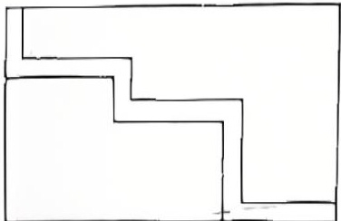

街心公园里有一块草坪，长 21 米，宽 16 米，草坪中间修有 1 米宽的小路，将草坪分成两块（如图）则草坪面积（阴影部分）是 $\_\_\_\_\_ m^{2}$.

第 4 题

> [!question]- 点击查看答案与解析
> 【答案】$315$
> 
> 【考点】平移思想、面积计算 → [[【初中数学知识点体系-人教版】#7-4 平移]]
> 
> 【解析】
> 由图可知，小路是沿着草坪的宽度方向（纵向）修建的，小路宽 1 米。
> 
> 将小路两侧的绿色草坪向中间平移拼接，可以得到一个新的矩形。
> 
> 新矩形的长 $= 21 - 1 = 20$（米）
> 
> 新矩形的宽 $= 16$（米）
> 
> $\therefore$ 草坪面积（阴影部分）$= 20 \times 16 = 320$（$m^2$）
> 
> **注意：** 若小路沿长度方向修建，则面积 $= 21 \times (16 - 1) = 21 \times 15 = 315$（$m^2$）
> 
> 根据图片，小路是横向的（沿长度方向），所以：
> 
> 草坪面积 $= 21 \times (16 - 1) = 21 \times 15 = 315$（$m^2$）
> 
> 【易错点】没有正确判断小路的方向，或者忘记用平移思想将两块草坪拼接成一个完整的矩形。
