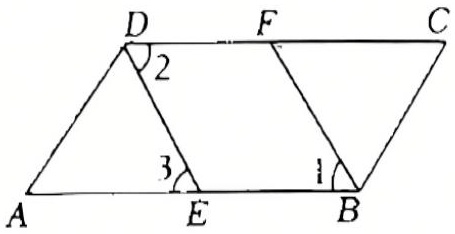

已知，如图，$\angle ABC = \angle ADC$，BF、DE 分别平分 $\angle ABC$ 与 $\angle ADC$，且 $\angle 1 = \angle 3$．试说明：$AB // DC$．（请根据条件进行推理，得出结论，并在括号内注明理由）

解：

$\because BF、DE 分别平分 \angle ABC 与 \angle ADC$ （已知）

$\therefore \angle1 = \frac{1}{2} \angle ABC, \angle 2 = \frac{1}{2} \angle ADC$ （$\_\_\_\_\_$），

$\because \angle ABC = \angle ADC \quad (\_\_\_\_\_)$,

$\therefore \angle \_\_\_\_\_\_ = \angle \_\_\_\_\_\_$ （等量代换）.

$\because \angle 1 = \angle 3$ （$\_\_\_\_\_$），

$\therefore \angle 2 = \angle \_\_\_\_\_\_$ （$\_\_\_\_\_$）.

$\therefore \_\_\_\_\_\_ // \_\_\_\_\_\_$ ($\_\_\_\_\_$).

> [!question]- 点击查看答案与解析
> 【答案】角平分线的定义；已知；$1$；$2$；已知；$3$；等量代换；$AB$；$DC$；内错角相等，两直线平行
> 
> 【考点】角平分线的定义、平行线的判定 → [[【初中数学知识点体系-人教版】#7-2 平行线]]
> 
> 【解析】
> $\because BF、DE$ 分别平分 $\angle ABC$ 与 $\angle ADC$（已知）
> 
> $\therefore \angle 1 = \frac{1}{2} \angle ABC, \angle 2 = \frac{1}{2} \angle ADC$（角平分线的定义）
> 
> $\because \angle ABC = \angle ADC$（已知）
> 
> $\therefore \angle 1 = \angle 2$（等量代换）
> 
> $\because \angle 1 = \angle 3$（已知）
> 
> $\therefore \angle 2 = \angle 3$（等量代换）
> 
> $\therefore AB // DC$（内错角相等，两直线平行）
> 
> 【易错点】不能熟练运用角平分线的定义，或者混淆内错角与同位角、同旁内角的关系，导致不能正确判定平行线。
