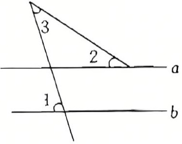

如图，已知 $\angle1 = 75^{\circ}$，$\angle2 = 35^{\circ}$，$\angle3 = 40^{\circ}$，求证：$a // b$。

> [!question]- 点击查看答案与解析
> 【答案】见解析
> 
> 【考点】三角形外角性质、平行线的判定 → [[【初中数学知识点体系-人教版】#7-2 平行线]]
> 
> 【解析】
> 由图可知，$\angle 1$ 是某个三角形的外角。
> 
> $\because \angle 2 = 35^\circ, \angle 3 = 40^\circ$（已知）
> 
> $\therefore \angle 2 + \angle 3 = 35^\circ + 40^\circ = 75^\circ$
> 
> $\because \angle 1 = 75^\circ$（已知）
> 
> $\therefore \angle 1 = \angle 2 + \angle 3$
> 
> 根据三角形外角的性质：三角形的一个外角等于与它不相邻的两个内角的和。
> 
> $\therefore a // b$（同位角相等，两直线平行）
> 
> 【易错点】不能正确识别三角形的外角与内角的关系，或者混淆同位角、内错角、同旁内角的判定条件。
